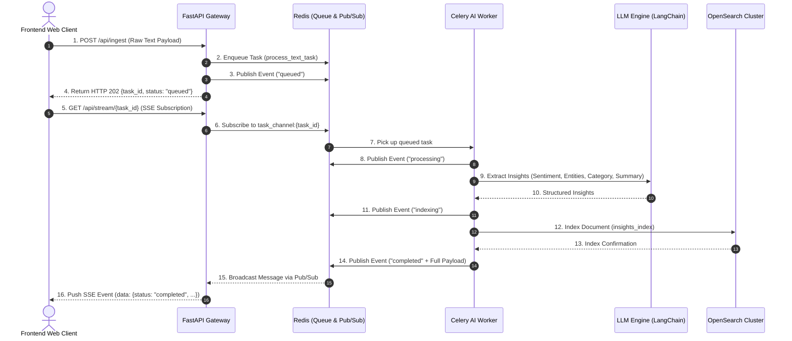

# ⚡ Real-Time AI Intelligence & Ingestion Pipeline

[](#)
[](#)
[](#)

An enterprise-grade, asynchronous, event-driven **Real-Time AI Intelligence & Ingestion Pipeline**. It processes unstructured text payloads (customer feedback, security logs, financial news), extracts structured insights using an LLM (sentiment, entities, categorization, summary), indexes documents into **OpenSearch** for real-time dashboards, and streams live processing updates directly to the frontend via **Server-Sent Events (SSE)**.

---

## 📐 Architecture & Flowchart

The system separates synchronous HTTP ingestion from heavy background LLM processing using a decoupled message queue topology:



---

## 💡 Key Architectural Features

* **Zero UI Freezes:** Fast, non-blocking HTTP POST response (`HTTP 202 Accepted`). LLM processing (which can take 2–30 seconds) runs completely off-thread in background Celery workers.
* **Non-Blocking Server-Sent Events (SSE):** FastAPI utilizes `asyncio` and `redis.asyncio` to stream state updates (`queued` -> `processing` -> `indexing` -> `completed`). The main Uvicorn event loop is never blocked, handling hundreds of concurrent streaming connections efficiently.
* **OpenSearch Analytics & Search:** Indexed structured outputs enable real-time search and visualization in **OpenSearch Dashboards** (e.g., sentiment distribution pie charts, timeseries log ingestion, category aggregations).
* **Resilient LLM Execution:** Integrates LangChain with OpenAI (`gpt-4o-mini`) / DeepInfra / Ollama with a automatic heuristic fallback analyzer for offline or zero-dependency environments.

---

## 🛠️ Technology Stack

* **API & Streaming:** FastAPI, Uvicorn, `redis.asyncio` Pub/Sub, SSE (`StreamingResponse`)
* **Background Queue & Workers:** Celery, Redis
* **AI & Extraction:** LangChain Core, LangChain Community, LangChain OpenAI
* **Search & Dashboards:** OpenSearch 2.12 (Single-Node), OpenSearch Dashboards
* **Orchestration:** Docker, Docker Compose
* **Testing:** Pytest, pytest-asyncio, HTTPX

---

## 📁 Repository Structure

```text
realtime-ai-pipeline/
├── backend/
│   ├── app/
│   │   ├── __init__.py
│   │   ├── celery_app.py      # Celery app initialization with Redis broker
│   │   ├── config.py          # Application settings & environment variables
│   │   ├── llm_extractor.py   # LangChain LLM extraction & heuristic fallback
│   │   ├── main.py            # FastAPI ingestion & async SSE endpoints
│   │   ├── opensearch_client.py# OpenSearch index creation & document indexing
│   │   └── worker.py          # Celery worker task & Redis Pub/Sub events
│   ├── tests/
│   │   ├── __init__.py
│   │   └── test_pipeline.py   # Complete unit and integration test suite
│   ├── Dockerfile
│   ├── Dockerfile.worker
│   └── requirements.txt
├── frontend/
│   └── index.html             # Responsive dark-mode live tracking dashboard
├── docker-compose.yml         # Container orchestration manifest
├── README.md
└── TUTORIAL.md
```

---

## 🚀 Quick Start & Deployment

### 1. Run via Docker Compose (Recommended)

To spin up Redis, OpenSearch, OpenSearch Dashboards, FastAPI, and the Celery Worker with a single command:

```bash
cd realtime-ai-pipeline
docker-compose up --build -d
```

### Access Services:
* **FastAPI Gateway:** `http://localhost:8000`
* **Swagger API Docs:** `http://localhost:8000/docs`
* **OpenSearch Cluster:** `http://localhost:9200`
* **OpenSearch Dashboards:** `http://localhost:5601`
* **Frontend Web Dashboard:** Open `realtime-ai-pipeline/frontend/index.html` in your web browser.

---

## 🔌 API Reference

### 1. Ingest Raw Text
Submit unstructured text for background AI analysis.

* **Endpoint:** `POST /api/ingest`
* **Content-Type:** `application/json`
* **Body:**
  ```json
  {
    "text": "Unauthorized charge on monthly subscription invoice #1029.",
    "source": "customer_feedback"
  }
  ```
* **Response (HTTP 202 Accepted):**
  ```json
  {
    "task_id": "c9a4b21d-9012-4e89-a2e1-45091bf28410",
    "status": "queued",
    "message": "Task queued for asynchronous AI processing and search indexing."
  }
  ```

### 2. Stream Live Status Updates (SSE)
Subscribe to real-time execution events.

* **Endpoint:** `GET /api/stream/{task_id}`
* **Headers:** `Accept: text/event-stream`
* **SSE Event Format:**
  ```http
  data: {"task_id": "c9a4b21d-9012-4e89-a2e1-45091bf28410", "status": "processing", "timestamp": "2025-02-22T12:00:01Z", "payload": {}}

  data: {"task_id": "c9a4b21d-9012-4e89-a2e1-45091bf28410", "status": "indexing", "timestamp": "2025-02-22T12:00:03Z", "payload": {}}

  data: {"task_id": "c9a4b21d-9012-4e89-a2e1-45091bf28410", "status": "completed", "timestamp": "2025-02-22T12:00:05Z", "payload": {"insights": {"sentiment": "Negative", "category": "Billing & Financial", "entities": ["invoice"], "summary": "Unauthorized charge on monthly subscription invoice #1029."}}}
  ```

---

## 🧪 Testing

The test suite validates ingestion REST endpoints, non-blocking SSE connections, heuristic LLM extraction, OpenSearch indexing payload formatting, and Celery worker task execution.

Run tests:
```bash
PYTHONPATH=realtime-ai-pipeline/backend python3 -m pytest realtime-ai-pipeline/backend/tests/ -v
```
